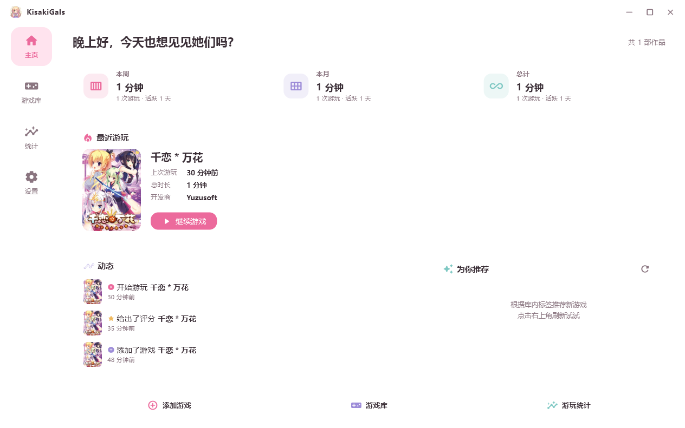
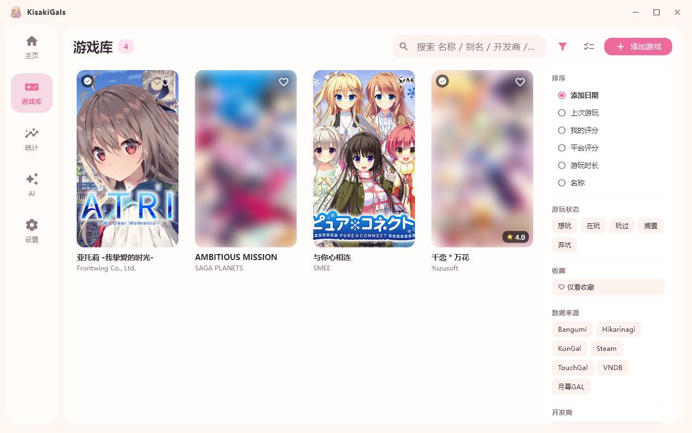
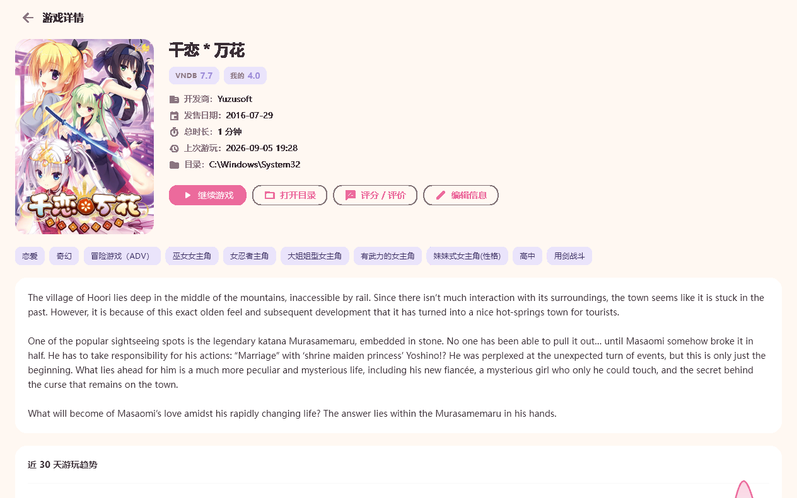
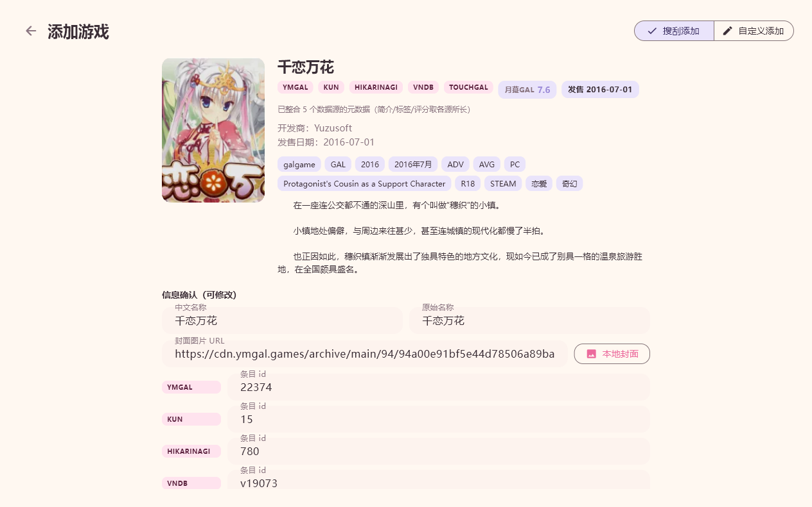
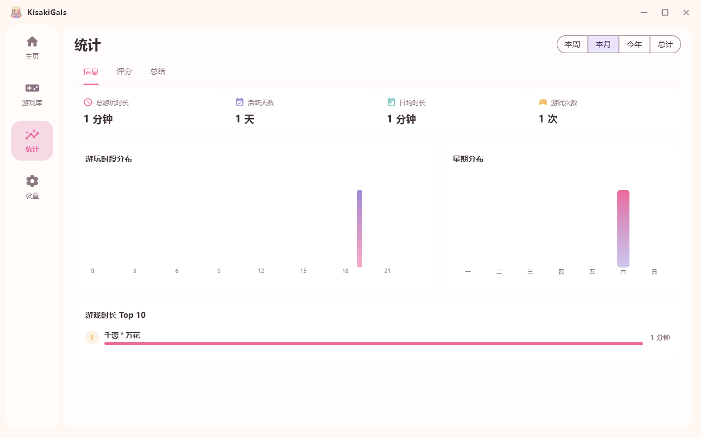
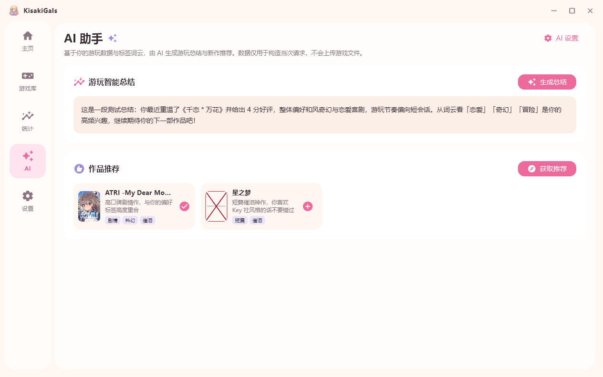
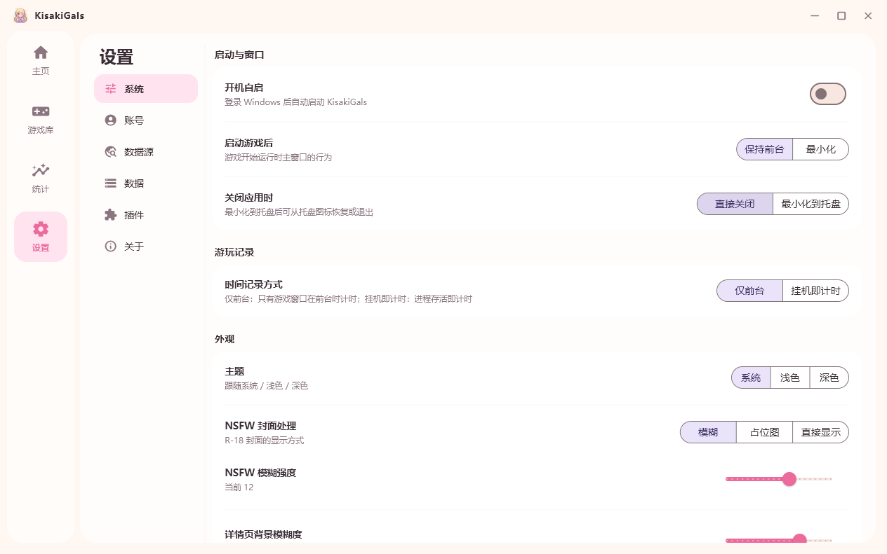
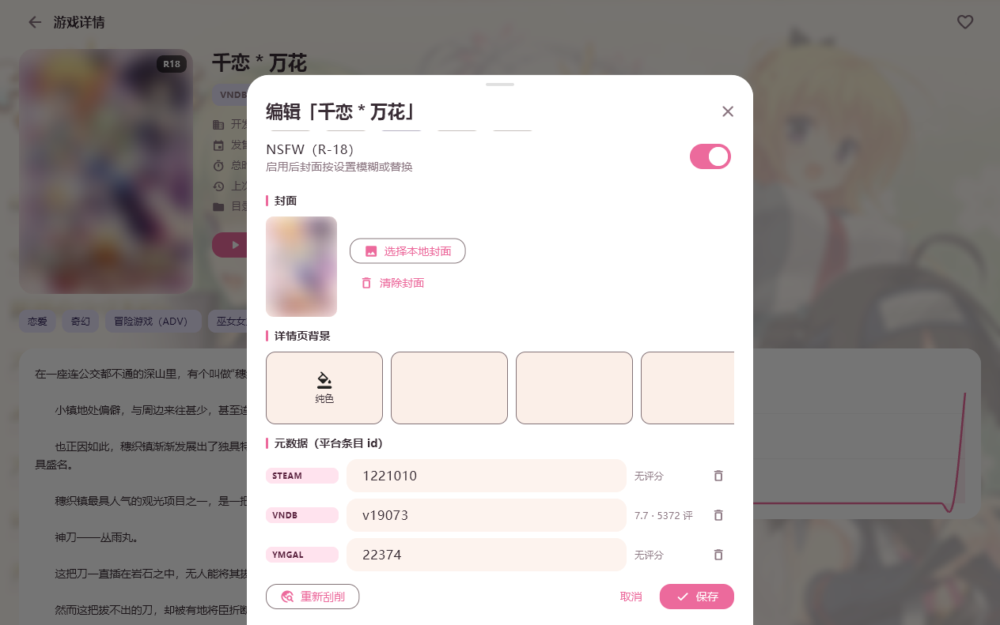

<div align="center">

# 🌸 KisakiGals

**Galgame 收藏、游玩时长与作品探索管理器** · Flutter Windows 桌面应用 · Fluent 2 (Windows 11) · 插件可扩展架构

> 「无论何时，都想与她们再次相见。」

**当前版本：1.2.0** ｜ 作者：MusaLunar ｜ [项目主页](https://github.com/MusaLunar/KisakiGals)

[](https://www.gnu.org/licenses/agpl-3.0)

</div>

---

## ✨ 功能

- 🏠 **主页**：Spotlight 聚光灯主推卡、本周/本月/总计 KPI 速览、最近游玩 & 待玩清单水平货架、动态时间线与基于库存标签的实时推荐
- 📚 **游戏库**：2:3 封面网格 / 紧凑列表切换，状态与收藏快捷筛选胶囊、可折叠 `FilterRail` 多维筛选与批量管理；与标题栏搜索框双向同步，支持拖拽 `.exe`/目录直接入库
- 🎮 **详情页**：游玩记录账本（总时长 / 本次实时计时 / 平均单次）、30 天游玩趋势、平台评分、标签与简介、`PlayPath` 截图时间线笔记，右上角 **「…」菜单** 支持按作品开启 **Locale Emulator 转区开关**
- 🧭 **探索与百科**：聚合浏览 VNDB / Bangumi 榜单与全网多源关键词搜索，与游戏库共享统一工具栏、筛选栏与网格/列表节奏；点击进入 **7 大工作台全景百科**（百科资料 / 媒体画廊 / 动画 / 音乐 / 漫画 / 轻小说 / 下载，其中「下载」Tab 顶部直接置顶站点发布页检索）
- 📊 **统计**：信息 / 评分 / 总结三页，含时段分布、星期分布、高分词墙与喜欢标签词云
- 🤖 **AI 助手**：结合真实游玩数据生成个性化总结与作品推荐（支持 DeepSeek / OpenAI / 阿里云通义 / 智谱 / Ollama / LM Studio 等 OpenAI 兼容接口）
- ➕ **入库**：侧栏「入库」与游戏库「添加游戏」完全统一，支持拖拽 `.exe`/`.lnk`/文件夹或关键词并发搜刮多平台元信息，自动多源合并
- 🧩 **插件系统与市场**：支持内置插件市场（含 GitHub 多镜像加速与 SHA-256 校验）及本地 `.zip` 导入安装；官方已发布 [`locale-emulator`](plugins/locale-emulator) 转区启动插件
- 🖥️ **Fluent 2 原生托盘弹窗**：C++ 原生自绘轻量 `MenuFlyout` 托盘菜单，与应用内右键菜单视觉一致，实时展示游玩会话、最近游玩直启与安全退出
- ⚡ **低配流畅模式 & 思源黑体**：内置 **Source Han Sans CN（思源黑体）** 与一键性能/流畅模式，兼顾 Windows 11 Mica/Acrylic 质感与低性能设备流畅度
- 🔑 **鲲Gal OAuth & 检查更新**：内置 RFC 7636 PKCE OAuth 2.0 授权登录与 NextMoe 读取同步；设置页支持 GitHub Releases 语义化在线检查更新

**游玩时长** · 秒级进程检测，仅前台计时或挂机计时双模式；标题栏与详情页实时显示本局时长；最小化到托盘也照常计时。

**存档与迁移** · 自动探测常见 Galgame 引擎存档目录，退出游戏后自动原子化备份存档，恢复前自动留保护快照；相对路径记录，便携文件夹拷贝即可跨设备自动重定位。

---

## 📸 截图

| | |
| --- | --- |
|  |  |
|  |  |
|  |  |
|  |  |

---

## 🚀 下载与运行

从 [Releases](https://github.com/MusaLunar/KisakiGals/releases) 下载：
- **安装包 (`KisakiGals-1.2.0-setup.exe`)**：标准 Windows 64 位安装向导，内置简体中文界面与可选桌面快捷方式（安装与卸载均不触碰用户数据）。
- **便携版 (`KisakiGals-1.2.0-portable.zip`)**：解压后直接运行 `kisakigals.exe`。数据（数据库、封面、存档备份、插件）均保存在同目录的 `data/` 文件夹，整目录拷贝即可迁移。

> 需要 **Windows 10 1809 或更高版本**（Windows 11 可体验 Mica / Acrylic 窗口材质）。

从源码构建（Flutter 3.x + Visual Studio 2022 C++ 桌面工作负载，打包安装包需 Inno Setup 6）：

```powershell
flutter pub get
flutter build windows --release
powershell -File tool/package.ps1 -Version 1.2.0
```

---

## ⚙️ 使用提示与插件开发

- **搜索与筛选**：在「游戏库」页面按 `Ctrl+F` 或 `Ctrl+K` 聚焦标题栏搜索框即可直接过滤本地游戏库；也可随时点击联想条目直达详情页。
- **添加游戏**：拖拽 `.exe` / `.lnk` / 游戏目录到游戏库或点击「添加游戏」，都会统一跳转至「入库」工作区并自动识别搜刮。
- **转区启动（Locale Emulator 插件）**：前往 **设置 → 插件与关于 → 浏览插件市场** 安装 **Locale Emulator 转区启动**（或导入 `.zip`），填入本机 [`LEProc.exe`](https://github.com/xupefei/Locale-Emulator) 路径；随后即可在任意游戏详情页右上角 **「…」** 菜单内单独开关该作的 LE 转区启动。
- **存档备份**：详情页「…」→ 存档备份，支持智能识别存档目录、自动轮转与恢复前快照。
- **AI 助手**：前往 **设置 → AI 服务** 选择预设服务商并填入 API Key / 模型后即可使用。
- **自己用 AI 开发插件**：人类开发者请阅读 [**Vibe Coding 插件实战指南 (`docs/VIBE_CODING_PLUGIN_GUIDE.md`)**](docs/VIBE_CODING_PLUGIN_GUIDE.md)；AI 编程助手技术规范请见 [**`docs/PLUGIN_DEVELOPMENT.md`**](docs/PLUGIN_DEVELOPMENT.md)。

---

## 🧩 灵感与致谢

参考了以下开源项目，特此致谢：

| 项目 | 参考内容 |
| --- | --- |
| [Locale Emulator](https://github.com/xupefei/Locale-Emulator) | Windows 非 Unicode 日文游戏转区启动工具（现以插件形式联动 `LEProc.exe`） |
| [The-Order](https://github.com/Ph-Rank/The-Order) | 多源全景游戏探索百科架构、跨媒体关联（动画/音乐/漫画/轻小说）、发行版本与制作人员组织模型启发 |
| [ChronoTide](https://github.com/hardman1314/-Chrono.Tide-) | 多源元数据刮削、VNDB 标签中文化资源、启动与存档管理思路 |
| [ReinaManager](https://github.com/huoshen80/ReinaManager) | 账号体系与多源元数据整合、存档备份策略、界面风格启发 |
| [SearchGal](https://github.com/Moe-Sakura/SearchGal) | 资源搜索的多站点聚合思路与结果呈现 |
| [LunaBox](https://github.com/Saramanda9988/LunaBox) | 元数据服务实现对照 |

元数据与搜索数据来自以下社区站点，版权归各站点与投稿者所有：Bangumi、VNDB、月幕GAL、Hikarinagi、Steam、KunGal、TouchGal、DLsite、CnGal，以及鲲Galgame、GAL图书馆、量子ACG、真红小站等资源站。

---

## 📜 许可

以 **AGPL-3.0** 发布（见 [LICENSE](LICENSE)）。内置的 VNDB 标签中文化资源来自 ChronoTide 项目（MIT）；内置字体采用 Adobe 开源的 [Source Han Sans（思源黑体）](https://github.com/adobe-fonts/source-han-sans)（SIL Open Font License 1.1）。

本项目与任何商业发行商无关，仅供学习与个人管理使用；请通过 Steam、DLSite 等正规渠道支持开发者。

---

<div align="center">
Made with Flutter & ♥ · KisakiGals v1.2.0
</div>
